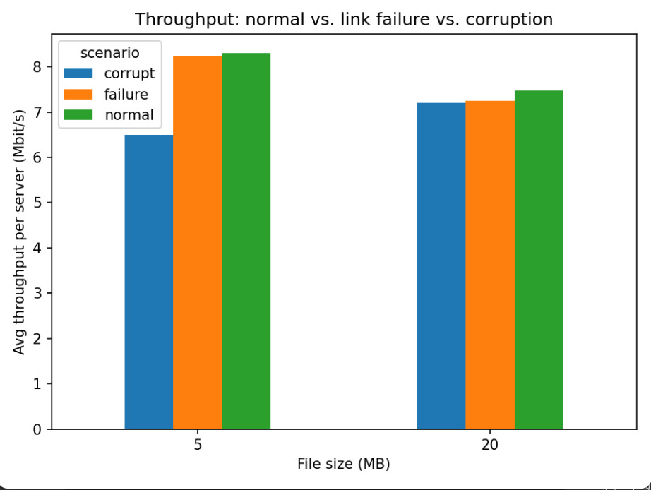

# Distributed Backup System with SDN Path Control

Computer Networks course project. A client replicates files to two backup servers over TCP, while a
Ryu-based SDN controller selects network paths and re-routes traffic when a link fails. The transfer
protocol adds chunking, SHA-256 integrity checks, and resumable transfers on top.

```
                 +-- s2 --+
   h1 -- s1 -----+        +---- s4 --+-- h3 (backup server 1)
 (client)        +-- s3 --+          +-- h4 (backup server 2)
```

## Project requirements covered

| Requirement | Where |
|---|---|
| TCP file transfer | `client.py`, `server.py` |
| Files divided into chunks | `client.py` (256 KB chunks) |
| Checksums for integrity | SHA-256 per chunk and for the whole file |
| Interrupted-transfer recovery | Client reconnects and resumes from the chunks the server already holds |
| Multiple backup servers | Two servers (h3, h4), full replication |
| Suitable network paths | `controller.py`: Dijkstra with `hops` or `load` policy, OpenFlow rules |
| Path failure simulation | `link s1 s2 down` in Mininet, or automated in `experiments.py` |
| Throughput and recovery time | `experiments.py` writes `results/results.csv`, `plot_results.py` draws graphs |

## Repository contents

| File | Role |
|---|---|
| `controller.py` | Ryu app: topology discovery, path selection, flow rules, link-failure reroute |
| `topology.py` | Mininet topology (1 client, 2 servers, 4 switches, redundant core) |
| `client.py` | Chunking, checksums, ACK/NACK, reconnect and resume, replication to all servers |
| `server.py` | Verifies and stores chunks, supports resume, verifies the whole file |
| `common.py` | Shared message framing and hash helpers |
| `experiments.py` | Automated runs (normal, link failure, corruption) |
| `plot_results.py` | Generates the graphs in `results/` |

## Requirements

- Ubuntu 20.04 or similar Linux (a VM is fine) with **Python 3.9** (`python3.9` and `python3.9-venv`)
- Mininet, Open vSwitch, and root access (`sudo`)
- Ryu 4.x with `eventlet==0.30.2` and NetworkX (installed in a virtual environment below)
- `pandas` and `matplotlib` for plotting

## Installation

Install Mininet and Open vSwitch:

```bash
sudo apt update
sudo apt install -y mininet openvswitch-switch python3-pip python3-venv iperf3 wireshark
sudo service openvswitch-switch start
```

Install Ryu in its own virtual environment (it is only used for the controller):

```bash
# 1. Build tools, in case pip needs to compile anything
sudo apt install -y build-essential python3-dev libffi-dev libssl-dev libxml2-dev libxslt1-dev zlib1g-dev

# 2. Fresh virtual environment
deactivate 2>/dev/null
rm -rf ~/ryu-env
python3.9 -m venv ~/ryu-env
source ~/ryu-env/bin/activate

# 3. Pin the build tools
pip install --upgrade "pip<24" "setuptools==65.5.0" wheel

# 4. Dependencies first, then Ryu without build isolation
pip install eventlet==0.30.2 networkx
pip install ryu --no-build-isolation
```

Verify the installation:

```bash
ryu-manager --version
python -c "import ryu, networkx, eventlet; print('ok')"
deactivate
```

The Mininet script, client, and server use the **system** `python3` and only the standard library.
For plotting: `pip3 install pandas matplotlib`.

## Running the project

### 1. Start the controller (Terminal 1)

```bash
source ~/ryu-env/bin/activate
cd backup-sdn
PATH_POLICY=hops ryu-manager --observe-links controller.py     # or PATH_POLICY=load
```

The controller must be started **before** Mininet and must use `--observe-links`.

### 2. Start the topology (Terminal 2)

```bash
cd backup-sdn
sudo python3 topology.py
```

The script waits about 6 seconds for link discovery, announces the hosts, and runs `pingall`.
Expect 0% packet loss, and `LINK UP`, `HOST h1 at s1:1`, and `PATH h1<->h3 via [...]` messages in the
controller terminal.

### 3. Manual demo (Mininet CLI)

```text
mininet> sh dd if=/dev/urandom of=/tmp/test.bin bs=1M count=30
mininet> h3 python3 server.py --port 5000 --dir /tmp/backup_h3 > /tmp/s3.log 2>&1 &
mininet> h4 python3 server.py --port 5000 --dir /tmp/backup_h4 > /tmp/s4.log 2>&1 &
mininet> h1 python3 client.py --servers 10.0.0.3 10.0.0.4 --file /tmp/test.bin &
```

While the transfer runs:

```text
mininet> sh ovs-ofctl -O OpenFlow13 dump-flows s1        # installed flow rules
mininet> link s1 s2 down                                  # cut the active path (or s1 s3)
mininet> link s1 s2 up
```

The controller logs `LINK DOWN` and `REROUTE`, the client continues (TCP retransmission, or an
application-level reconnect and resume), and the servers finish with
`whole-file SHA-256 verified OK`. Verify the copies:

```bash
sha256sum /tmp/test.bin /tmp/backup_h3/test.bin /tmp/backup_h4/test.bin
```

To demonstrate the checksum mechanism, add `--corrupt-chunks 2,5` to the client command. The server
rejects those chunks with a NACK and the client resends them.

### 4. Automated experiments

Exit the manual topology (`exit`, then `sudo mn -c`), keep the controller running, and run:

```bash
sudo python3 experiments.py --sizes 5 20 --reps 3
python3 plot_results.py
```

Use files large enough that the transfer lasts longer than `--fail-after` (default 1.5 s). With
20 Mbit/s links and two replicas, a 20 MB file takes about 16 s. Run once per path policy (`hops` and
`load`) to compare them.

Metrics recorded in `results/results.csv`:

- **throughput**: file size divided by transfer time, per server (includes any recovery stall)
- **recovery_s**: time of the first ACK after the link is cut, minus the cut time (maximum over servers)
- **max_ack_gap_s**: longest stall between consecutive ACKs
- **nacks**, **reconnects**, **integrity_ok**

## Results

Average throughput per backup server for 5 MB and 20 MB files under three scenarios: a normal
transfer, a transfer with a link failure injected mid-run, and a transfer with deliberately corrupted
chunks.



- **Normal vs. link failure:** throughput is nearly identical (about 8.3 vs. 8.2 Mbit/s at 5 MB, and
  about 7.5 vs. 7.25 Mbit/s at 20 MB). The controller re-routes the flow shortly after the link goes
  down, so the stall is small relative to the total transfer time. Measured recovery times are in
  `results/results.csv`.
- **Corruption:** the 5 MB run is slowest (about 6.5 Mbit/s) because the corrupted chunks are NACKed
  and resent, and that fixed cost is a larger share of a small transfer. At 20 MB the penalty is small.
- **Absolute values:** throughput stays below the 20 Mbit/s core link capacity because both replicas
  share the uplink from s1, so each server gets roughly half of it at best.

## Design decisions

- **Replication** to both servers (simple and a true backup), with one client thread per server.
- **Chunk size of 256 KB** for fine-grained resume and recovery measurement, with SHA-256 per chunk and
  for the whole file.
- **Stop-and-wait** ACK/NACK with at most 5 resends per chunk. The server is idempotent (chunks are
  written atomically), so duplicates are harmless.
- **Two-level recovery:** the controller re-routes within milliseconds of the port-down event. If TCP
  still stalls past the 5 s socket timeout, the client reconnects, asks the server which chunks it
  holds, and resumes from there.
- **Path policy:** `hops` (baseline) versus `load` (measured port transmit rate used as the Dijkstra
  weight, evaluated when a flow is set up).
- **No flooding:** static ARP and controller-learned host locations avoid broadcast storms on the
  looped topology.

## Limitations

- Stop-and-wait limits throughput compared with a pipelined or windowed protocol.
- Paths are chosen per host pair, not per TCP connection.
- The `load` policy only influences path choice at flow setup; established flows are not rebalanced.
- In the automated experiments, the injected failure always targets the s1 uplink carrying the transfer.

## Troubleshooting

- `pingall` fails: start the controller first with `--observe-links`, then run `sudo mn -c` and retry.
- `ryu-manager` raises an `ALREADY_HANDLED` import error: `pip install eventlet==0.30.2 --force-reinstall`.
- Ryu fails to build: use Python 3.9 and the pinned build tools from the installation steps.
- No `LINK UP` messages: start Open vSwitch with `sudo service openvswitch-switch start`.
- Controller port 6653 already in use: run `sudo mn -c` and stop any old `ryu-manager` process.
- Servers overwrite each other's files: each server needs its own `--dir`.
- Slow failover: if the port-down event is not reported, Ryu falls back to LLDP timeouts (a few seconds).
